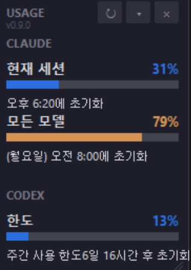
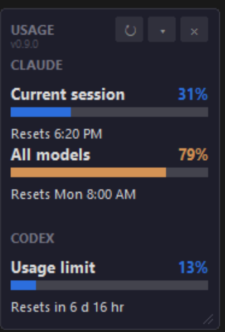

# Claude Codex Usage for Windows

[한국어](#한국어) · [English](#english)

Claude와 Codex 구독 사용량을 **작업표시줄 위의 작은 위젯**이나 **Claude·Codex 앱 창의
제목 표시줄 배지**로 보여 주는 Windows 도구입니다. 모델을 호출하지 않으므로 사용량을
확인해도 할당량이 줄지 않습니다.

A small Windows tool that shows your Claude and Codex subscription usage in an
**always-on-top widget** above the taskbar and/or as **badges on the Claude and
Codex app title bars**. It never calls a model, so checking usage costs no quota.

| 위젯 (한국어) / Widget (Korean) | 위젯 (영어) / Widget (English) |
| :---: | :---: |
|  |  |

**Claude 앱 제목 표시줄 배지 / Badge on the Claude app title bar**


**Codex 앱 제목 표시줄 배지 / Badge on the Codex app title bar**


---

## 한국어

### 주요 기능

- **Claude·Codex 사용량을 함께 표시**: 퍼센트는 **사용한 양** 기준이라 쓸수록 막대가
  찹니다. 75% 이상은 주황, 90% 이상은 빨강입니다.
- **표시 방식 3가지**: 위젯만 / 앱 제목 표시줄 배지만 / 위젯 + 배지(기본).
- **보기 모드 5가지**(위젯): 자동(기본) / Claude만 / Codex만 / 둘 다 보기 / 둘 다(좌우 전환).
- **한국어·영어**: 메뉴뿐 아니라 페이지에서 읽어 온 초기화 시간과 한도 이름까지 고른
  언어로 보여 줍니다.
- **위젯 안에서 복구**: 동기화가 실패하면 우클릭 메뉴에서 다시 시도, 브라우저 재시작,
  다시 로그인을 할 수 있습니다.
- **완전 제거**: 메뉴나 `uninstall.cmd` 한 번으로 프로그램 폴더까지 남김없이 지웁니다.

### 요구 사항

- Windows 10 또는 11
- Chrome 또는 Edge
- Python 3 또는 [uv](https://docs.astral.sh/uv/) (둘 중 하나)
- Git (선택): 있으면 `git pull`로 업데이트하고, 새 버전이 나오면 위젯에 알림이 뜹니다.
- [Codex CLI](https://github.com/openai/codex) (선택): Codex 데이터 소스를
  `로컬 CLI 기록`으로 쓸 때만 필요합니다.

### 설치

**git으로 설치 (권장)**: 업데이트가 `git pull` 한 줄로 끝납니다. 예를 들어 `문서`
폴더에 설치하려면:

```cmd
cd /d %USERPROFILE%\Documents
git clone https://github.com/minsk8775/Claude-Codex-usage.git
cd Claude-Codex-usage
install.cmd
```

**ZIP으로 설치**: [최신 릴리스](https://github.com/minsk8775/Claude-Codex-usage/releases/latest)에서
ZIP을 받아 원하는 곳에 풀고 `install.cmd`를 실행합니다.

관리자 권한은 필요 없습니다. 설치하면 바탕화면 바로가기와 시작 프로그램 항목이 생기고
위젯이 한 번 실행됩니다. OneDrive로 동기화되는 `문서` 폴더에 둬도 됩니다.

### 처음 로그인

Claude와 ChatGPT(Codex)는 이 앱 전용 브라우저 프로필을 따로 씁니다. 평소 쓰는
Chrome의 로그인은 쓰지 않으므로 **각각 한 번씩** 로그인해야 합니다.

1. 위젯의 `↻`를 누릅니다. 로그인이 필요하면 전용 브라우저 창이 열립니다.
2. 열린 창에서 Claude(또는 ChatGPT)에 로그인합니다.
3. 사용량 페이지가 보이면 `↻`를 다시 누릅니다.

로그인이 풀리면 우클릭 → `동기화 문제 해결` → `다시 로그인 (브라우저 창)`으로 같은 창을
다시 엽니다.

### 표시 방식

창 아무 곳이나 알림 영역 아이콘을 우클릭 → `표시 방식`에서 고릅니다.

| 방식 | 설명 |
| --- | --- |
| 위젯만 | 작업표시줄 위에 떠 있는 위젯만 씁니다. |
| 앱 제목 표시줄 배지만 | 위젯 없이 Claude·Codex 앱 창의 배지로만 봅니다. 알림 아이콘, 바로가기, 배지를 눌러도 위젯은 뜨지 않고 `표시 방식`을 바꿀 때만 다시 나옵니다. 이 모드에서는 알림 아이콘 메뉴의 위젯 전용 항목(항상 위, 위치 초기화, 표시/숨기기, 좌우 전환)이 회색으로 잠깁니다. |
| 위젯 + 제목 표시줄 배지 (기본) | 둘 다 씁니다. |

**배지**는 Claude 앱과 Codex(ChatGPT) 앱 창의 제목 표시줄에 붙습니다. Claude 앱에서는
앱 도구 모음(메뉴·폴더·공유 버튼) 왼쪽, Codex 앱에서는 –/□/× 버튼 왼쪽에 놓여 앱의
버튼을 가리지 않습니다. 한도별 사용량 %, 얇은 막대, 초기화까지 남은 시간을 보여 줍니다.

- 창을 옮기면 따라가고, 최소화하면 숨고, 다른 창에 가려지면 같이 가려집니다.
- 드래그하면 위치를 앱별로 기억합니다. 배지 우클릭 → `배지 위치 초기화`로 되돌립니다.
- 배지를 더블클릭하면 위젯이 열립니다(배지만 모드에서는 제외).
- 앱이 켜져 있을 때만 그 앱의 사용량을 동기화합니다.
- 보기 모드의 `Claude만 보기` / `Codex만 보기`는 배지에도 적용돼, 고른 앱의 배지만 나옵니다.
  나머지 모드에서는 두 앱 모두 배지가 나옵니다.

### 보기 모드 (위젯)

위젯의 `▾` 버튼, 위젯 우클릭, 또는 알림 아이콘 우클릭으로 고릅니다.

- **자동 (앱에 맞춰)** (기본): Claude 앱만 켜져 있으면 Claude만, ChatGPT 앱만 켜져
  있으면 Codex만, 둘 다 켜져 있으면 둘 다 보여 줍니다. 두 앱이 모두 꺼지면 위젯이
  숨고, 앱을 다시 켜면 나타납니다.
- **Claude만 보기** / **Codex만 보기**: 한쪽만 봅니다.
- **둘 다 보기**: 한 창에 위아래로 둘 다 봅니다.
- **둘 다 (좌우 전환)**: 한 번에 하나씩, `‹ ›` 화살표로 넘깁니다.

`×`나 알림 아이콘으로 숨기면 같은 앱이 켜져 있는 동안 숨김이 유지됩니다. 감시 대상
앱을 새로 열면 다시 나타납니다.

### 조작

| 동작 | 방법 |
| --- | --- |
| 위치 옮기기 | 버튼과 크기 손잡이를 뺀 아무 곳이나 드래그. 다른 모니터로 옮겨도 그 자리에 있고, 재시작 후에도 유지됩니다. |
| 위치 되돌리기 | 우클릭 → `위치 초기화 (시계 위로)` |
| 크기 조절 | 오른쪽 아래 손잡이를 드래그하거나 `Ctrl` + 마우스 휠 |
| 즉시 동기화 | `↻` |
| 앱 열기 | 위젯의 Claude 부분 더블클릭 → Claude 앱, Codex 부분 → ChatGPT 앱. 앱이 없으면 웹사이트가 열립니다. |
| 숨기기 / 표시 | `×`, 또는 알림 아이콘 왼쪽 클릭 |
| 항상 위 | 우클릭 → `항상 위` |
| Codex 데이터 소스 | 우클릭 → `Codex 데이터 소스` → `공식 페이지 (브라우저)` / `로컬 CLI 기록` |
| Codex Spark 표시 | 우클릭 → `Codex Spark 사용량도 표시` (기본 꺼짐) |
| 동기화 문제 해결 | 우클릭 → `동기화 문제 해결` → `다시 시도` / `리더 브라우저 재시작` / `다시 로그인 (브라우저 창)` |
| 언어 | 우클릭 → `언어 (Language)` → `한국어` / `영어 (English)` |
| 종료 | 알림 아이콘 우클릭 → `종료` |
| 제거 | 우클릭 → `제거 (Uninstall)` |

위젯 헤더의 `USAGE` 아래에 현재 버전이 작게 표시됩니다.

### 사용량을 읽는 방식

- **Claude** (`usage.py`): 전용 Chrome/Edge 프로필로 Claude 공식 `설정 → 사용량`
  페이지를 열고, 화면에 그려진 값만 읽습니다.
- **Codex: 공식 페이지 (기본)** (`codex_web.py`): 같은 방식으로 ChatGPT 공식 사용량
  페이지를 읽습니다. ChatGPT 앱·웹·Work 사용량까지 포함된 실제 한도입니다. 페이지는
  `남음`으로 보여 주지만, 위젯은 Claude와 맞추려고 **사용한 양**으로 바꿔 보여 줍니다.
- **Codex: 로컬 CLI 기록** (`codex_usage.py`): 로그인 없이 Codex CLI가
  `~/.codex/sessions`에 남긴 기록만 읽습니다. CLI 사용분만 보입니다.
  - 기본으로는 일반 Codex 한도(현재 세션 + 주간)만 보여 줍니다. `Codex Spark 사용량도
    표시`를 켜면 모델별 한도(예: GPT-5.3-Codex-Spark)도 함께 보이고, 라벨에 `· Spark`
    처럼 태그가 붙습니다.
  - 일반 한도가 오래됐고 모델별 한도만 쓰는 중이면, 토글이 꺼져 있어도 그 한도를
    보여 줘서 위젯이 낡은 값에 멈추지 않습니다.
  - 5분이 지났거나 초기화 시각을 넘긴 기록은 회색과 `오래된 기록`으로 표시합니다.

전용 브라우저는 화면에 보이지 않게 뒤에서 돌고, 위젯을 끌 때 함께 닫힙니다.

### 업데이트

위젯은 **스스로 업데이트를 설치하지 않습니다.** git으로 설치한 경우 시작할 때 한 번만
읽기 전용으로 확인(`git fetch`)하고, 새 버전이 있으면 헤더에 빨간
**`● 업데이트 필요`** 배지를 띄웁니다. 배지를 누르면 GitHub가 열립니다. 바뀐 내용을
확인한 뒤 설치 폴더에서 실행하세요.

```cmd
git pull
install.cmd
```

ZIP으로 설치했다면 `uninstall.cmd`로 지운 뒤 새 ZIP을 받아 `install.cmd`를 실행합니다.
확인 자체를 끄려면 환경 변수 `CLAUDE_CODEX_NO_UPDATE=1`을 설정하거나
`claude_usage.pyw` 옆에 빈 `.noupdate` 파일을 둡니다.

### 제거

우클릭 → `제거 (Uninstall)`, 또는 설치 폴더의 `uninstall.cmd`를 실행합니다. 되돌릴 수
없으며 다음을 모두 지웁니다.

- 위젯, 시작 프로그램 감시자, 제목 표시줄 배지, 전용 브라우저
- 바탕화면·시작 프로그램 바로가기 (옛 단독 위젯의 바로가기 포함)
- 설정·캐시·로그 (`%LOCALAPPDATA%\ClaudeCodexUsage`)
- 로그인 정보가 든 전용 브라우저 프로필 (`%LOCALAPPDATA%\ClaudePet`)
- 프로그램 폴더 자체 (git 설치의 숨김 `.git` 포함)

제거하는 동안 그 폴더를 열어 둔 cmd 창이나 탐색기 창이 있으면 폴더가 남을 수 있습니다.
창을 닫고 폴더를 지우면 됩니다. pywin32와 uv 캐시는 다른 프로그램도 같이 쓰므로
남겨 둡니다.

### 데이터 위치

| 위치 | 내용 |
| --- | --- |
| `%LOCALAPPDATA%\ClaudeCodexUsage` | `settings.json`(설정·위젯 위치), `latest.json` / `codex_latest.json`(사용량 캐시), `badge_positions.json`, `error.log` |
| `%LOCALAPPDATA%\ClaudePet` | 전용 브라우저 프로필 (`BrowserProfile` = Claude, `CodexBrowserProfile` = ChatGPT) |

프로그램 폴더에는 아무것도 쓰지 않습니다. 그래서 위젯을 끄면 프로그램 폴더를 바로
지우거나 옮길 수 있습니다.

### 보안

- 쿠키·토큰·자격 증명 파일은 읽지 않습니다. 페이지에 그려진 사용량 값과 Codex CLI가
  남긴 기록만 봅니다.
- 외부에서 접근할 수 있는 포트를 열지 않습니다. 브라우저 디버그 포트는 이 PC 안에서만
  열리고 origin 제한이 걸려 있습니다. 위젯 제어 포트(`127.0.0.1:47671/47672`)는 셸이
  아니라 정해진 명령만 받습니다.
- 업데이트를 자동으로 내려받아 실행하지 않으므로, 저장소가 바뀌거나 탈취돼도 임의
  코드가 이 PC에서 실행되지 않습니다.

localhost origin 제한은 클라이언트 인증이 아니므로, 같은 사용자 권한으로 도는 다른
로컬 프로그램은 DevTools에 접근할 수 있습니다. 전체 신뢰 모델과 신고 방법은
[`SECURITY.md`](SECURITY.md)를 참고하세요.

### 문제 해결

| 증상 | 해결 |
| --- | --- |
| `공식 사용량 동기화 실패` (timed out) | 우클릭 → `동기화 문제 해결` → `리더 브라우저 재시작` |
| `로그인 필요` / `연결 필요` | `↻`를 누르거나 `동기화 문제 해결` → `다시 로그인 (브라우저 창)` |
| Codex 값이 ChatGPT 앱과 다름 | `Codex 데이터 소스`가 `공식 페이지 (브라우저)`인지 확인 |
| 폴더가 안 지워짐 | 위젯을 종료하고 그 폴더를 연 cmd·탐색기 창을 닫은 뒤 다시 시도 |
| 그 밖의 오류 | `%LOCALAPPDATA%\ClaudeCodexUsage\error.log` 확인 |

### 파일 구성

| 파일 | 역할 |
| --- | --- |
| `claude_usage.pyw` | 위젯 UI, 알림 아이콘, 표시 방식·보기 모드, 제거 |
| `usage.py` | Claude 공식 사용량 페이지 읽기 (브라우저) |
| `codex_web.py` | ChatGPT 공식 사용량 페이지 읽기 (브라우저, Codex 기본) |
| `codex_usage.py` | 로컬 `~/.codex` 기록 읽기 (Codex `로컬 CLI 기록` 모드) |
| `title_badges.py` | 앱 제목 표시줄 배지 (보조 프로세스) |
| `install.py` / `install.cmd` | 설치, 바로가기 만들기 |
| `uninstall.cmd` | 완전 제거 |
| `cleanup-legacy.cmd` | 옛 단독 위젯(Claude 전용·Codex 전용) 중지·등록 해제 |
| `tests/` | 오프라인 회귀 테스트 |

### 오프라인 점검

```cmd
python -m unittest discover -s tests -v
python codex_usage.py --self-test
python codex_web.py --self-test
python usage.py --self-test
```

테스트는 가짜 기록과 목(mock)만 씁니다. 마지막 명령은 일회용 프로필로 브라우저를 띄워
오프라인 DOM·프로토콜 점검을 하며, Claude 로그인은 쓰지 않습니다.

### 라이선스

MIT

---

## English

### Features

- **Claude and Codex usage together.** Percentages are **used** quota, so bars
  fill as you consume it; orange from 75%, red from 90%.
- **Three display modes:** widget only / title-bar badges only / widget + badges
  (default).
- **Five view modes** for the widget: auto (default) / Claude only / Codex only /
  both stacked / both with arrows.
- **Korean and English.** Not just the menus: reset times and limit names read
  from the pages are shown in the language you pick.
- **In-widget recovery** when a sync fails: retry, restart the reader browser, or
  sign in again from the right-click menu.
- **Clean uninstall** from the menu or `uninstall.cmd`, down to the program
  folder itself.

### Requirements

- Windows 10 or 11
- Chrome or Edge
- Python 3 or [uv](https://docs.astral.sh/uv/) (either one)
- Git (optional): update with `git pull` and get notified of new versions.
- [Codex CLI](https://github.com/openai/codex) (optional): only needed for the
  `Local CLI log` Codex data source.

### Installation

**With git (recommended)**, so updating is a single `git pull`. For example, into
`Documents`:

```cmd
cd /d %USERPROFILE%\Documents
git clone https://github.com/minsk8775/Claude-Codex-usage.git
cd Claude-Codex-usage
install.cmd
```

**From a ZIP:** download it from the
[latest release](https://github.com/minsk8775/Claude-Codex-usage/releases/latest),
extract it anywhere, and run `install.cmd`.

No administrator rights are needed. The installer creates a desktop shortcut and a
Startup entry and starts the widget once. A OneDrive-synced `Documents` folder is
fine.

### First sign-in

Claude and ChatGPT (Codex) each use a dedicated browser profile owned by this app,
not your everyday Chrome, so sign in to **each one once**:

1. Click `↻` on the widget. If a sign-in is needed, a dedicated browser window opens.
2. Sign in to Claude (or ChatGPT) in that window.
3. Once the usage page shows, click `↻` again.

If a session expires, right-click → `Fix sync issues` → `Re-sign in (browser)`
opens the same window again.

### Display modes

Right-click anywhere on the widget or the notification-area icon → `Display`.

| Mode | What it does |
| --- | --- |
| Widget only | Only the floating widget above the taskbar. |
| Title-bar badges only | No widget, just badges on the Claude and Codex app windows. The tray icon, the shortcut and the badges never bring the widget back; only changing `Display` does. Widget-only tray menu items (always on top, reset position, show/hide, arrows view) are greyed out in this mode. |
| Widget + title-bar badges (default) | Both. |

**Badges** sit on the Claude and Codex (ChatGPT) app title bars without covering
the apps' own buttons: left of the app toolbar (menu, folder, Share) in Claude,
and left of the –/□/× buttons in Codex. They show each limit's percentage, a thin bar, and the time
left until reset.

- They follow the window, hide when it is minimized, and are covered with it.
- Drag one to move it; the spot is remembered per app. Right-click → `Reset badge
  position` puts it back.
- Double-click a badge to open the widget (except in badges-only mode).
- Only apps that are running are synced for their badges.
- The `Claude only` / `Codex only` view modes apply to badges too, so only that
  app's badge shows; every other view mode shows both.

### View modes (widget)

Pick one from the widget's `▾` button, by right-clicking the widget, or from the
notification icon.

- **Auto (follow apps)** (default): only Claude open → Claude only, only ChatGPT
  open → Codex only, both open → both. When both apps close the widget hides, and
  it comes back when either opens.
- **Claude only** / **Codex only**
- **Both (stacked)**: both in one window.
- **Both (arrows)**: one at a time, flipped with `‹ ›`.

Hiding the widget with `×` or the tray icon lasts while the same apps stay open;
opening a watched app brings it back.

### Controls

| Action | How |
| --- | --- |
| Move | Drag anywhere except the buttons and the resize grip. It stays on whichever monitor you put it on, across restarts. |
| Reset position | Right-click → `Reset position` |
| Resize | Drag the bottom-right grip, or `Ctrl` + mouse wheel |
| Sync now | `↻` |
| Open the app | Double-click the Claude part → Claude app; the Codex part → ChatGPT app. The website opens if the app is not installed. |
| Hide / show | `×`, or left-click the notification icon |
| Always on top | Right-click → `Always on top` |
| Codex data source | Right-click → `Codex data source` → `Official page (browser)` / `Local CLI log` |
| Codex Spark usage | Right-click → `Also show Codex Spark usage` (off by default) |
| Fix sync issues | Right-click → `Fix sync issues` → `Retry now` / `Restart reader browser` / `Re-sign in (browser)` |
| Language | Right-click → `Language` → `한국어 (Korean)` / `English` |
| Exit | Right-click the notification icon → `Exit` |
| Uninstall | Right-click → `Uninstall` |

The current version is shown in small type under `USAGE` in the header.

### How usage is read

- **Claude** (`usage.py`) opens Claude's official `Settings → Usage` page in a
  dedicated Chrome/Edge profile and reads only the values rendered on the page.
- **Codex, official page (default)** (`codex_web.py`) reads the official ChatGPT
  usage page the same way, so usage from the ChatGPT app, web and Work is
  included. The page reports what is *left*; the widget converts it to *used* to
  match Claude.
- **Codex, local CLI log** (`codex_usage.py`) reads only what the Codex CLI wrote
  under `~/.codex/sessions`, with no sign-in. It sees CLI usage only.
  - By default only the general Codex limit (current session + weekly) is shown.
    Turn on `Also show Codex Spark usage` to add model-specific limits (e.g.
    GPT-5.3-Codex-Spark), tagged like `· Spark`.
  - If the general limit is stale because only a model limit is in use, that model
    limit is shown even with the toggle off, so the widget never freezes on an old
    value.
  - Records older than five minutes or past their reset time are greyed out and
    marked stale.

The dedicated browsers run hidden in the background and close with the widget.

### Updates

The widget **never installs updates by itself.** In a git install it does one
read-only check at startup (`git fetch`); if a newer version exists, a red
**`● Update available`** badge appears in the header and opens GitHub when
clicked. Review the changes, then run in the install folder:

```cmd
git pull
install.cmd
```

For a ZIP install, run `uninstall.cmd`, download the new ZIP and run `install.cmd`.
To turn the check off, set `CLAUDE_CODEX_NO_UPDATE=1` or put an empty `.noupdate`
file next to `claude_usage.pyw`.

### Uninstall

Right-click → `Uninstall`, or run `uninstall.cmd` in the install folder. This
cannot be undone. It removes:

- the widget, the Startup watcher, the title-bar badges and the dedicated browsers
- the desktop and Startup shortcuts (including the older standalone widgets' ones)
- settings, caches and logs (`%LOCALAPPDATA%\ClaudeCodexUsage`)
- the dedicated browser profiles holding the sign-ins (`%LOCALAPPDATA%\ClaudePet`)
- the program folder itself (including a git install's hidden `.git`)

A cmd or Explorer window left open inside the folder can keep it from being
removed; close it and delete the folder. pywin32 and the uv cache are shared with
other programs and are left alone.

### Where data lives

| Location | Contents |
| --- | --- |
| `%LOCALAPPDATA%\ClaudeCodexUsage` | `settings.json` (settings, widget position), `latest.json` / `codex_latest.json` (usage cache), `badge_positions.json`, `error.log` |
| `%LOCALAPPDATA%\ClaudePet` | Dedicated browser profiles (`BrowserProfile` = Claude, `CodexBrowserProfile` = ChatGPT) |

Nothing is written to the program folder, so it can be deleted or moved as soon as
the widget is closed.

### Security

- It never reads cookies, tokens or credential files, only the usage values
  rendered on the pages and the records the Codex CLI already wrote.
- It opens no ports reachable from outside. The browser debug port is
  loopback-only and origin-restricted, and the widget's control ports
  (`127.0.0.1:47671/47672`) accept a fixed set of commands, never a shell.
- It never downloads and runs updates, so a repointed or compromised repository
  cannot run code on your machine.

The localhost origin restriction is not client authentication: other local
programs running as the same user can still reach DevTools. See
[`SECURITY.md`](SECURITY.md) for the full trust model and how to report an issue.

### Troubleshooting

| Symptom | Fix |
| --- | --- |
| `Official usage sync failed` (timed out) | Right-click → `Fix sync issues` → `Restart reader browser` |
| `Sign-in needed` / `needs sign-in` | Click `↻`, or `Fix sync issues` → `Re-sign in (browser)` |
| Codex numbers differ from the ChatGPT app | Make sure `Codex data source` is `Official page (browser)` |
| The folder will not delete | Exit the widget, close any cmd/Explorer window inside the folder, try again |
| Anything else | Check `%LOCALAPPDATA%\ClaudeCodexUsage\error.log` |

### Project files

| File | Purpose |
| --- | --- |
| `claude_usage.pyw` | Widget UI, notification icon, display and view modes, uninstall |
| `usage.py` | Claude usage from the official Usage page (browser) |
| `codex_web.py` | Codex usage from the official ChatGPT page (browser, the default) |
| `codex_usage.py` | Codex usage from local `~/.codex` logs (`Local CLI log` mode) |
| `title_badges.py` | Title-bar badges (helper process) |
| `install.py` / `install.cmd` | Installation and shortcuts |
| `uninstall.cmd` | Full removal |
| `cleanup-legacy.cmd` | Stops and unregisters the older standalone widgets |
| `tests/` | Offline regression tests |

### Offline checks

```cmd
python -m unittest discover -s tests -v
python codex_usage.py --self-test
python codex_web.py --self-test
python usage.py --self-test
```

The tests use synthetic logs and mocks only. The last command starts a browser with
a disposable profile for an offline DOM/protocol check; no Claude sign-in is used.

### License

MIT
